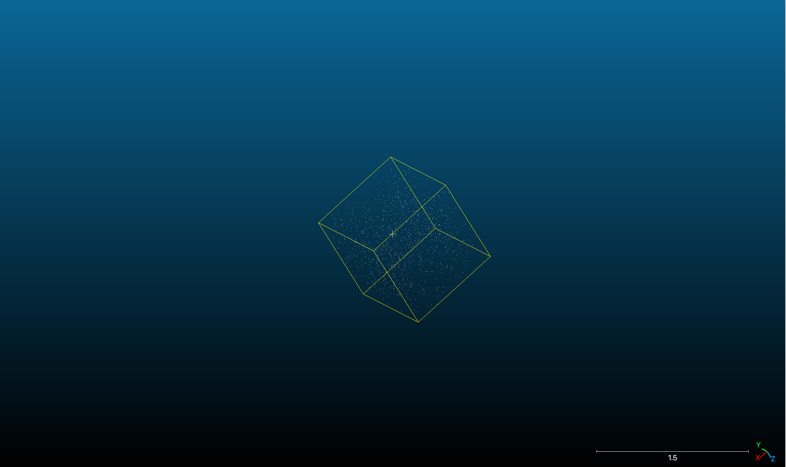
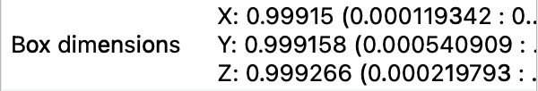
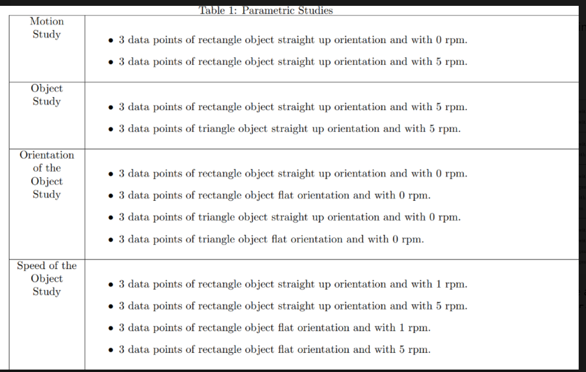

<div align="center">

# LiDAR Point-Cloud Motion Pipeline

**A small Python pipeline for analysing motion in LiDAR / depth-camera point-cloud sequences: dimensions from axis-aligned bounding boxes, principal-axis orientation via PCA, frame-pair motion detection, and ICP-based rotation-rate estimation — all built directly on top of Open3D and NumPy with no opaque vendor library in the loop.**

[](https://www.python.org/downloads/)
[](https://www.open3d.org/)
[](LICENSE)

</div>

<p align="center">

&nbsp;

</p>

---

## What it does

Given a sequence of LiDAR `.pcd` files captured at known timestamps,
the pipeline answers four questions:

1. **What size is the imaged object?** — axis-aligned bounding-box
   extents (`pcd_motion.dimensions`).
2. **Which way is it pointing?** — unsigned principal axis from PCA on
   the cloud's covariance matrix (`pcd_motion.orientation`).
3. **Is it moving between frames?** — cheap mean-displacement test
   used to gate the expensive ICP step (`pcd_motion.motion`).
4. **How fast is it rotating, and about what axis?** — ICP-based
   point-to-point registration recovers the SO(3) transform between
   each frame pair, decomposes it into axis/angle, and reports the
   average rotation rate in deg/s and RPM (`pcd_motion.speed`).

A working sample dataset of 10 LiDAR captures of a rotating rectangle
is included under [`data/sample/`](data/sample/) — the pipeline can be
run end-to-end out of the box with no external data.

---

## Quick start

```bash
git clone https://github.com/Janga786/lidar-pointcloud-motion-pipeline.git
cd lidar-pointcloud-motion-pipeline

python -m venv .venv && source .venv/bin/activate
pip install -e ".[dev]"

# Sample run on the included rotating-rectangle dataset
python scripts/run_pipeline.py
```

Expected output (your numbers will vary slightly with sample density):

```
loading 10 frames from data/sample/ …
  motion detector       : object is MOVING
  average rotation rate : 4.97 deg/s  (0.83 RPM)
  average rotation axis : [-0.005  0.998 -0.061]
  frame  0 extents      : [0.214 0.395 0.013]
  frame  1 extents      : [0.218 0.394 0.014]
  ...
```

---

## The pipeline, stage by stage

### 1. `preprocess.py` — load and clean

LiDAR captures contain spurious returns at infinity (no echo within
the sensor's range) and NaN values where the time-of-flight
electronics couldn't lock onto a phase.  Both wreck downstream
algorithms — PCA gets dominated by a single Inf, ICP fails its
Cholesky decomposition, bounding boxes blow up to infinite extent.
The loader strips these before any later stage sees them.

### 2. `dimensions.py` — bounding-box extents

The simplest possible "size" estimator: the axis-aligned bounding box
of the cloud.  Robust to typical LiDAR sparsity (a single returning
beam still contributes a sample to each axis) but sensitive to object
orientation (a rotated rectangle reads larger than its physical size
because the AABB has to grow to enclose the rotated extents).
Pair with `orientation.py` for orientation-invariant sizing.

### 3. `orientation.py` — PCA principal axis

The textbook PCA recipe applied to a 3 × *N* coordinate matrix:
subtract the centroid, form the 3 × 3 covariance matrix, run a
symmetric eigendecomposition (`np.linalg.eigh` is faster and more
numerically stable than `np.linalg.eig` because the covariance
matrix is guaranteed symmetric), and return the eigenvector with the
largest eigenvalue.  The result is the **unsigned** direction of
maximum variance — PCA cannot tell apart "long axis points +x" from
"long axis points −x".

### 4. `motion.py` — coarse motion gate

A cheap mean-displacement test between consecutive frames.  Used to
*gate* the expensive ICP computation in stage 5: if no motion is
detected, the pipeline reports the object as stationary and skips
the rotation analysis entirely.  False positives are tolerable (an
extra ICP evaluation), false negatives are bad (missed motion), so
the threshold is intentionally low (1 cm by default).

### 5. `speed.py` — ICP-based rotation rate

The headline algorithm.  Given two consecutive point clouds, point-to-
point ICP recovers the SO(3) transform that aligns the second to the
first.  We decompose that transform into an axis/angle pair using

$$
\theta = \arccos\!\left(\frac{\operatorname{tr} R - 1}{2}\right),
\qquad
\hat n = \frac{1}{2 \sin \theta}
\bigl( R_{32} - R_{23},\; R_{13} - R_{31},\; R_{21} - R_{12} \bigr)
$$

with safeguards at the degenerate angles (θ = 0 and θ = π).
Summed over the whole sequence, this produces the average rotation
rate in deg/s and a mean rotation axis.

For tumbling motion (axis itself rotating in the body frame), the
arithmetic mean of axes is no longer the right answer; the natural
generalisation is a Karcher mean on SO(3), which is left as an
extension exercise.

---

## Repository layout

```
lidar-pointcloud-motion-pipeline/
├── src/pcd_motion/             # the library (importable Python package)
│   ├── __init__.py             # public API
│   ├── preprocess.py           # 1. load + drop NaN/Inf
│   ├── dimensions.py           # 2. AABB extents
│   ├── orientation.py          # 3. PCA principal axis
│   ├── motion.py               # 4. frame-pair displacement test
│   └── speed.py                # 5. ICP rotation-rate estimation
│
├── scripts/
│   ├── run_pipeline.py         # end-to-end driver
│   └── xbin_to_pcd.py          # convert vendor `.xbin` → standard `.pcd`
│
├── data/sample/                # 10-frame rotating-rectangle dataset
│
├── tests/
│   └── test_pcd_motion.py      # synthetic-cloud unit tests
│
├── docs/                       # study photos + dimensional sketches
├── pyproject.toml
├── requirements.txt
├── LICENSE
└── README.md
```

## Testing

```bash
pytest -q                # synthetic-cloud unit tests
```

The test suite uses procedurally-generated point clouds (no LiDAR
hardware required) to verify:

- AABB extents recover the synthesised box dimensions to within 5 %.
- PCA correctly identifies the long axis of a 5 × 0.1 × 0.1 stick.
- The motion detector flags translated clouds and clears static ones.
- The axis/angle decomposition round-trips through a known SO(3)
  rotation to floating-point precision.
- ICP recovers a 5° rotation about z to within 1°.

## Hardware reference

The sample dataset was captured on an industrial time-of-flight LiDAR
sensor mounted in a controlled rotating-target rig:

<p align="center">

</p>

Different rotation rates (5 RPM, 15 RPM, …) and target shapes
(rectangle, triangle, etc.) were captured to validate the pipeline
across a range of conditions.  See `docs/` for additional reference
images.

## License

[MIT](LICENSE) — software is free for commercial, academic and educational use.
